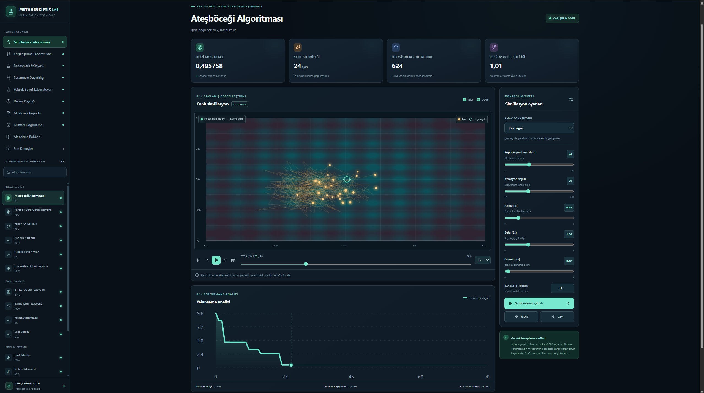
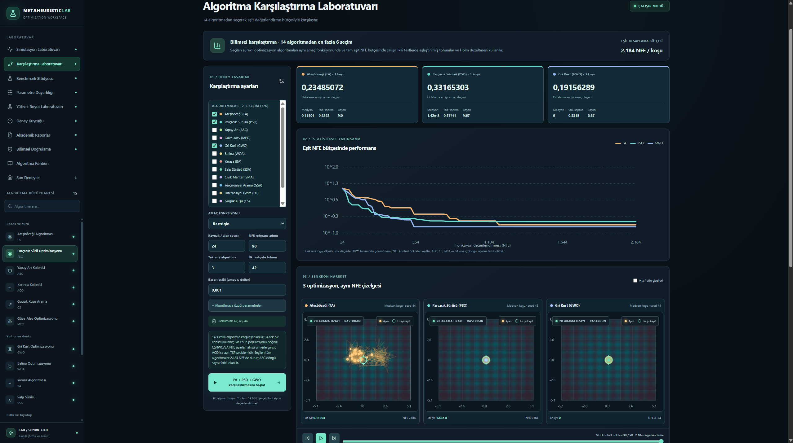
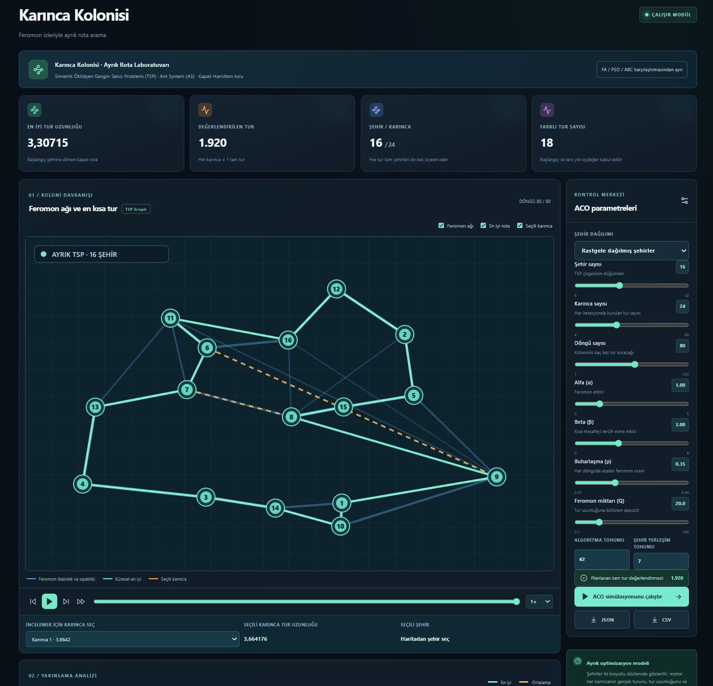
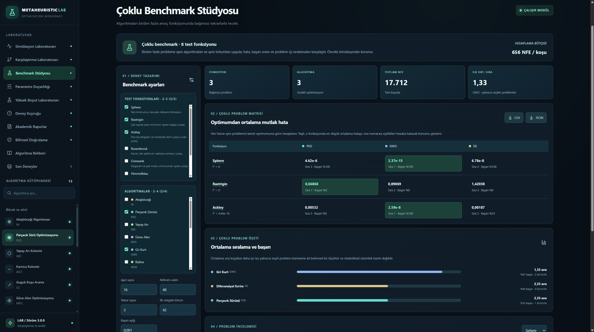
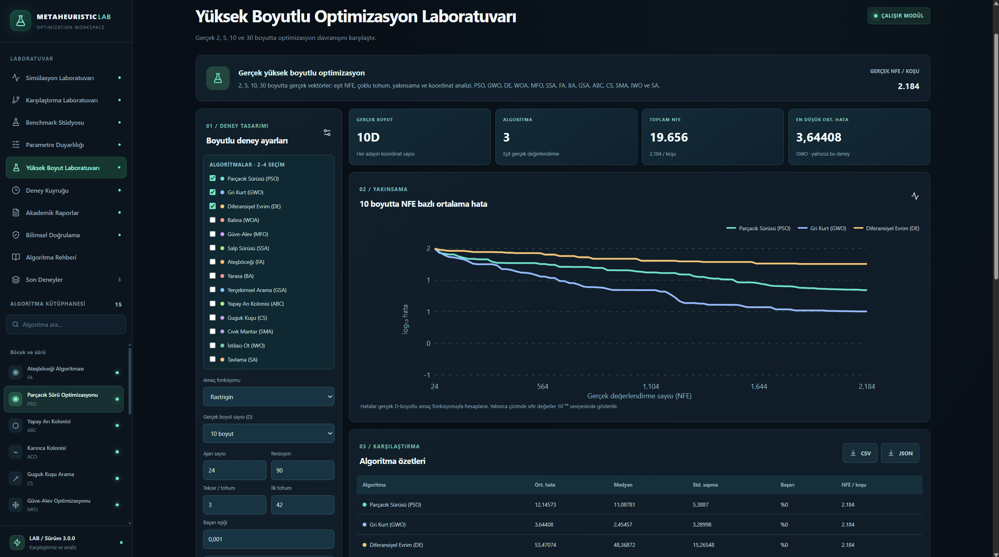
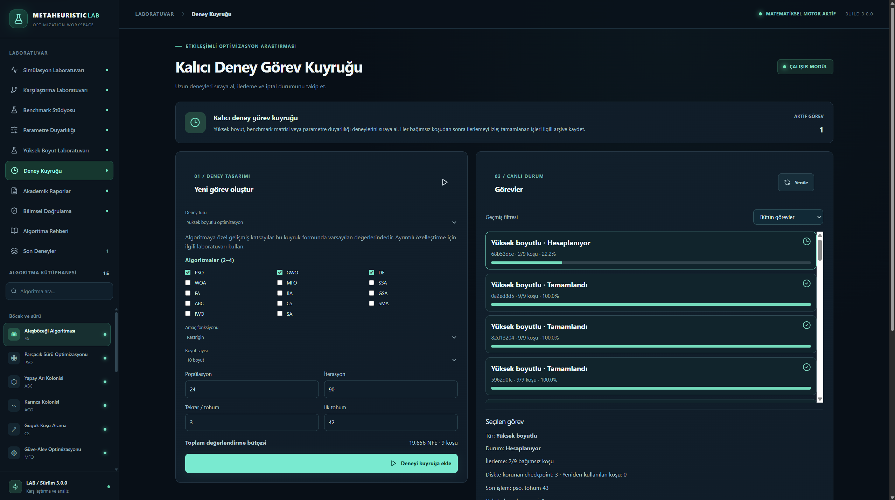
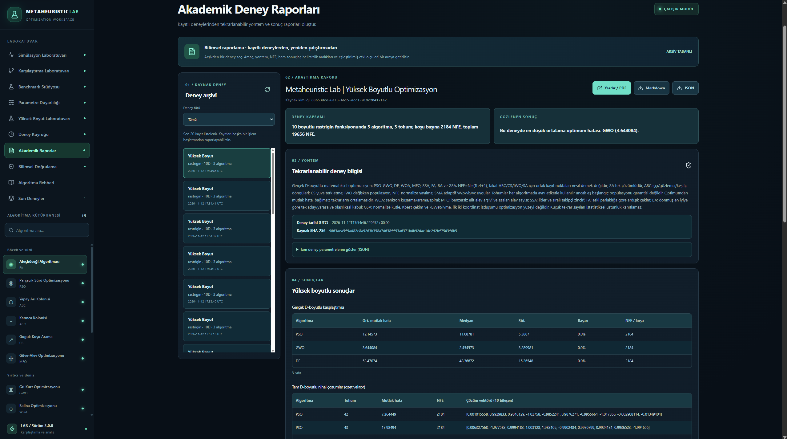
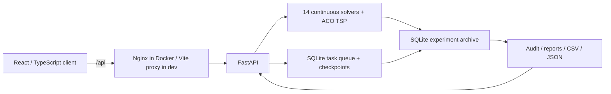

# Metaheuristic Lab

**A research-oriented workspace for visualizing and evaluating metaheuristic optimization algorithms.**

**Language:** [English](README_EN.md) · [Türkçe](README_TR.md)

> **Release 3.0.0 · Local research/portfolio edition.** The web application is designed for one computer and does **not** provide authentication, HTTPS termination, multi-tenant isolation, or a hosted public service. It must not be exposed directly to the public Internet.

## At a glance

| Scope | What is implemented |
| --- | --- |
| **15 algorithms** | FA, PSO, ABC, ACO, CS, MFO, GWO, WOA, BA, SSA, SMA, IWO, SA, GSA, DE |
| **14 continuous optimizers** | D-dimensional runs for D = 2, 5, 10, 30, with stored full-dimensional solution vectors |
| **Discrete problem** | ACO solves a Euclidean travelling-salesperson problem (TSP), not a continuous objective |
| **Research labs** | Interactive simulations, fixed-NFE comparison, benchmark matrix, OFAT sensitivity, high-dimensional laboratory, academic reports, scientific audit, persistent job queue |
| **Research integrity** | Seeded repeated runs, explicit objective evaluations (NFE), convergence traces, SQLite archives, optional CSV/JSON/Markdown/printable HTML exports |
| **Reliability** | SQLite per-run checkpoints, retries, cancellation between runs, backup utility, Pytest, Playwright, Docker + Nginx, GitHub Actions |

## Live interface • real screenshots

<p align="center">
  <a href="docs/screenshots/final/01-firefly-overview.png">
    
  </a>
</p>

*Actual v3.0.0 application capture · Firefly Algorithm / Rastrigin. Screenshots show recorded runs, not synthesized UI.*

| Equal-NFE comparison | Discrete ACO / TSP |
|:---:|:---:|
| [](docs/screenshots/final/06-comparison-convergence.png) | [](docs/screenshots/final/04-aco-tsp-route.png) |
| **Controlled convergence** · multiple methods with equal function-evaluation budgets | **Route optimization** · discrete Euclidean TSP |
| Multi-benchmark matrix | High-dimensional optimization |
| [](docs/screenshots/final/08-benchmark-matrix.png) | [](docs/screenshots/final/13-dimensional-results.png) |
| **Across objective functions** · Sphere, Rastrigin, Ackley | **True D-dimensional vectors** · shown with an explicitly labeled projection |
| Persistent experiment queue | Reproducible academic reports |
| [](docs/screenshots/final/15-job-queue-running.png) | [](docs/screenshots/final/18-academic-report-overview.png) |
| **SQLite checkpoints** · run-level progress and recovery | **Archive-based reporting** · method, results and export options |

**[Explore all 23 screenshots in the organized gallery →](docs/SCREENSHOT_GALLERY.md)** · [Türkçe görsel anlatım](README_TR.md) · [English feature guide](README_EN.md)

## Start locally

**Windows 11 (PowerShell):**

```powershell
cd backend
py -3.13 -m venv .venv
.\.venv\Scripts\python.exe -m pip install -r requirements-dev.txt
.\.venv\Scripts\python.exe -m uvicorn app.main:app --reload
```

In a **second** terminal:

```powershell
cd frontend
npm.cmd install
npm.cmd run dev
```

Open <http://127.0.0.1:5173>. API docs: <http://127.0.0.1:8000/docs>.

**Docker (local-only):**

```powershell
docker compose up --build -d --wait
# open http://127.0.0.1:5173
docker compose down
```

The web container serves compiled React via Nginx, while FastAPI stays on the internal Docker network. Run `scripts/backup_experiments.py` before updating a populated environment. See [local deployment](docs/DEPLOY_LOCAL.md).

## Run checks

```powershell
cd backend
.\.venv\Scripts\python.exe -m pytest -q
```

```powershell
cd frontend
npm.cmd run build
npm.cmd run report:bundle
npm.cmd run test:e2e
```

For Windows, `scripts/verify_windows.ps1` combines the principal checks; `scripts/verify_docker_windows.ps1` verifies the running containers. The Rollup WASM workaround for environments blocking native `.node` modules is documented in [frontend/ROLLUP_WASM_WINDOWS.md](frontend/ROLLUP_WASM_WINDOWS.md).

## Architecture



A more detailed diagram and module responsibilities appear in [docs/FINAL_ARCHITECTURE.md](docs/FINAL_ARCHITECTURE.md).

## Research methodology and boundaries

- Continuous experiments use **the number of objective-function evaluations (NFE)** as the comparison budget. Equal NFE does **not** imply equal wall-clock time or identical generation counts.
- Algorithms such as ABC, CS, IWO and SA use explicitly documented NFE-controlled adapters. Same-labeled random seeds do not guarantee identical initial populations.
- The two-axis visualization of a D-dimensional run is an **(x1, x2) projection**, not the optimized D-dimensional surface.
- Bootstrap intervals and paired comparisons are **exploratory** with small samples; no global superiority is claimed.
- The built-in audit recomputes objectives using the **same implementation**. This is a consistency check, not independent validation against external benchmark libraries.

Read [research limitations](docs/RESEARCH_LIMITATIONS.md), [methods](docs/DIMENSIONAL_METHODOLOGY.md) and [reproducibility protocol](docs/REPRODUCIBILITY.md).

## Documentation

| Purpose | File |
| --- | --- |
| Turkish guide | [README_TR.md](README_TR.md) |
| English guide | [README_EN.md](README_EN.md) |
| Architecture | [docs/FINAL_ARCHITECTURE.md](docs/FINAL_ARCHITECTURE.md) |
| Scientific reproducibility | [docs/REPRODUCIBILITY.md](docs/REPRODUCIBILITY.md) |
| API / Docker setup | [docs/DEPLOY_LOCAL.md](docs/DEPLOY_LOCAL.md) |
| Limitations / safety | [docs/RESEARCH_LIMITATIONS.md](docs/RESEARCH_LIMITATIONS.md), [SECURITY.md](SECURITY.md) |
| Full annotated screenshot gallery | [docs/SCREENSHOT_GALLERY.md](docs/SCREENSHOT_GALLERY.md) |
| Illustrated academic deck (PPTX / PDF) | [PPTX](docs/academic/Metaheuristic_Lab_Academic_Presentation_v3.0.0.pptx) · [PDF](docs/academic/Metaheuristic_Lab_Academic_Presentation_v3.0.0.pdf) |
| Illustrated technical report (PDF) | [Technical Report](docs/academic/Metaheuristic_Lab_Academic_Technical_Report_v3.0.0.pdf) |
| Final release and verification | [docs/RELEASE_v3.0.0.md](docs/RELEASE_v3.0.0.md), [docs/RELEASE_CHECKLIST.md](docs/RELEASE_CHECKLIST.md) |
| Academic and career publication kit | [docs/PORTFOLIO_KIT_TR.md](docs/PORTFOLIO_KIT_TR.md) |
| Algorithm-specific method descriptions | [docs/](docs/) |

## Screenshot provenance and privacy

The final gallery contains **23 user-captured images (22 planned views + one additional mobile view)**, not generated mock-ups. Selected images may show local job or archive identifiers; review these before publishing a public repository. The complete archive is at [`docs/screenshots/final/`](docs/screenshots/final/) with context at [Screenshot Gallery](docs/SCREENSHOT_GALLERY.md). Narrow crops of settings and job history are intentionally displayed as details, not full-page captures.

## License and publication

The source code is published under the **[MIT License](LICENSE)** (Copyright © 2026 Fatih Yılmaz). Review attribution, collaborator permissions and screenshot content before any public release. Third-party assets, names and trademarks, if any, remain subject to their respective rights. See [docs/RELEASE_CHECKLIST.md](docs/RELEASE_CHECKLIST.md).
