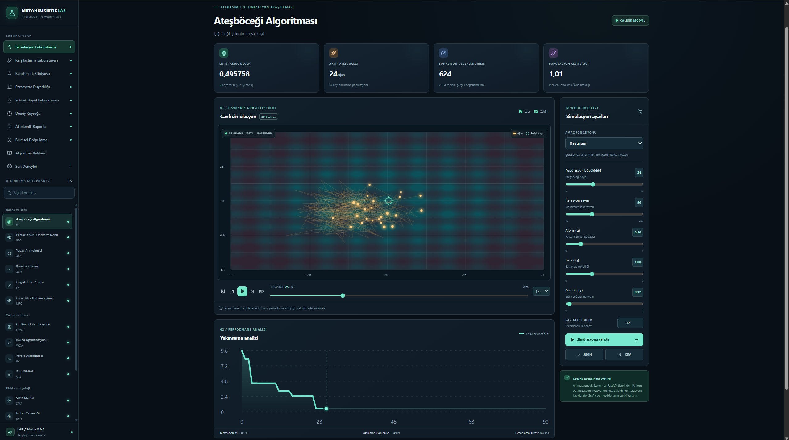
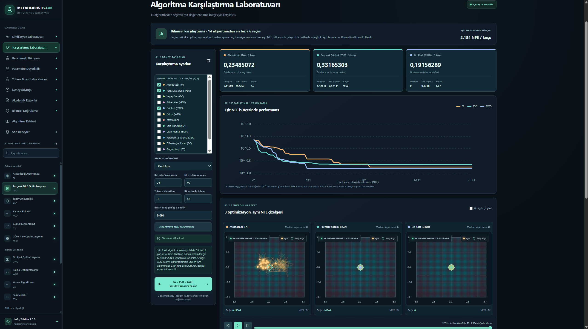
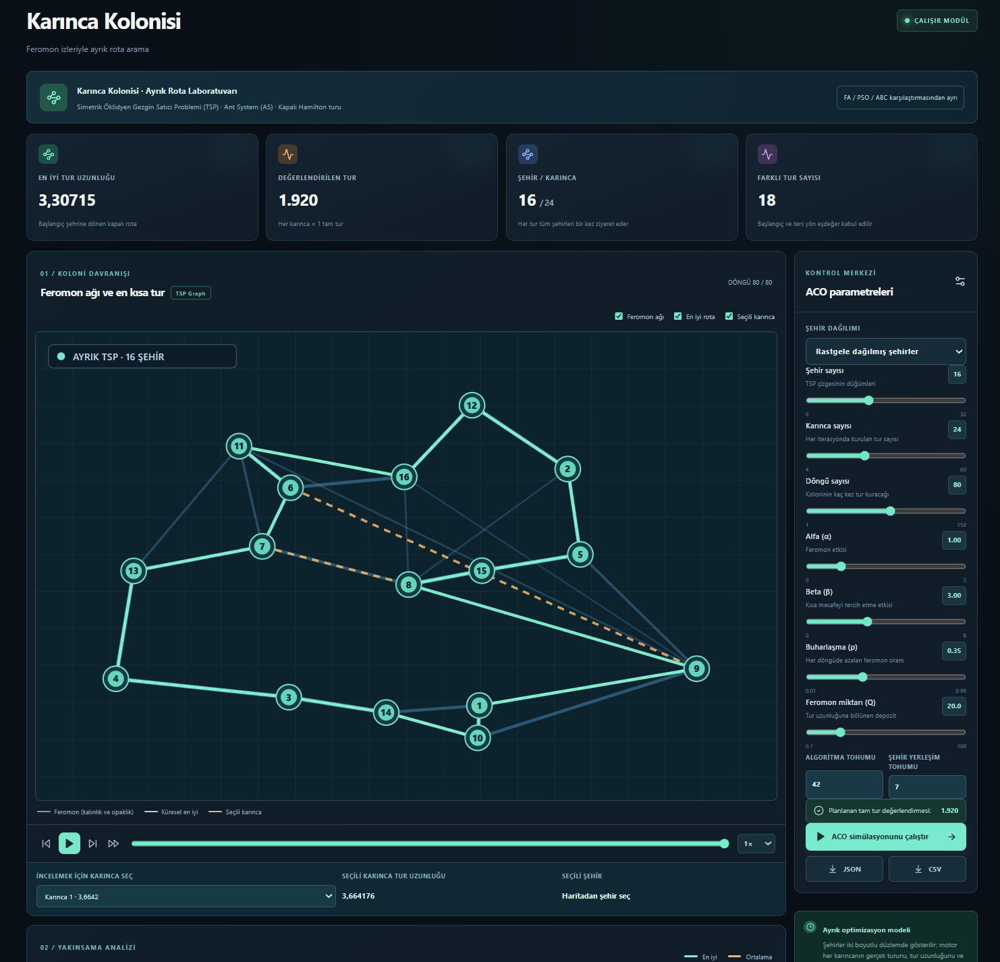
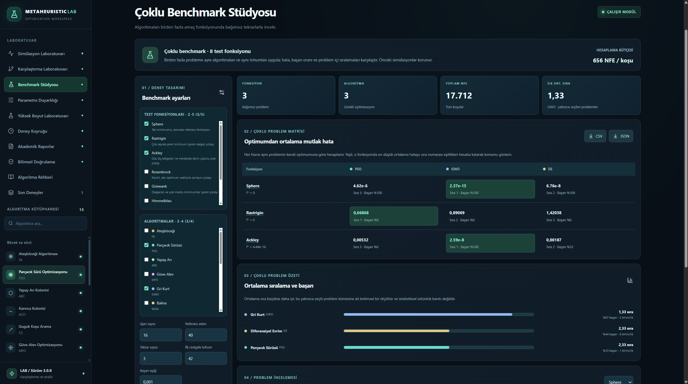
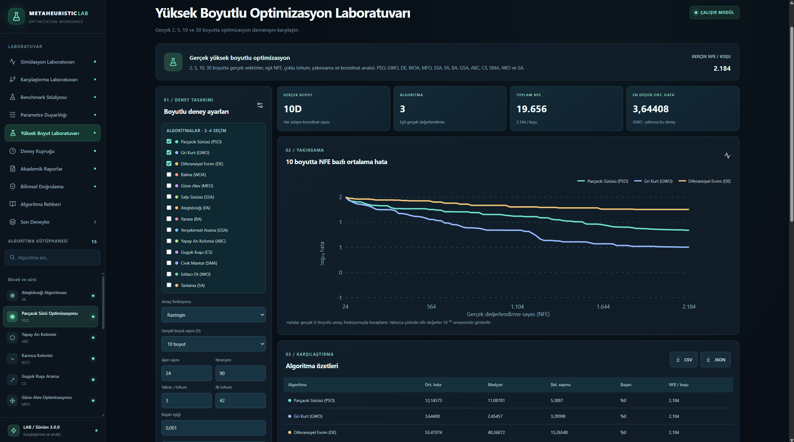
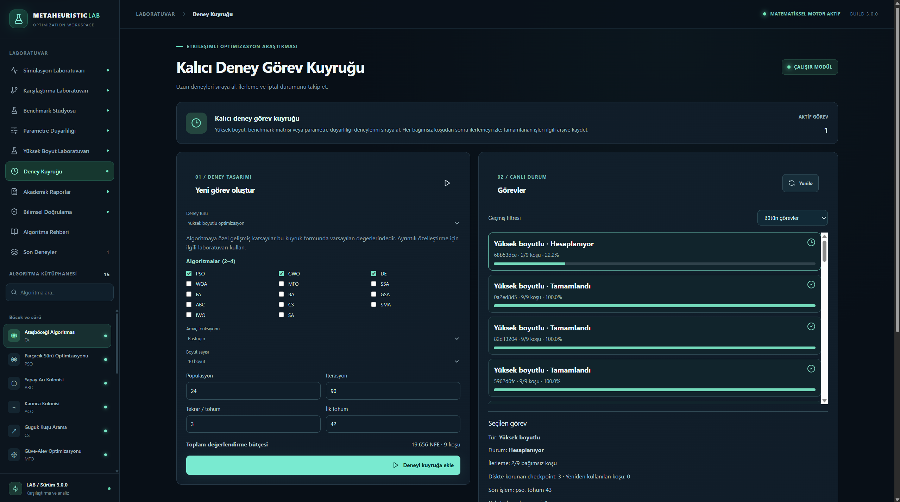
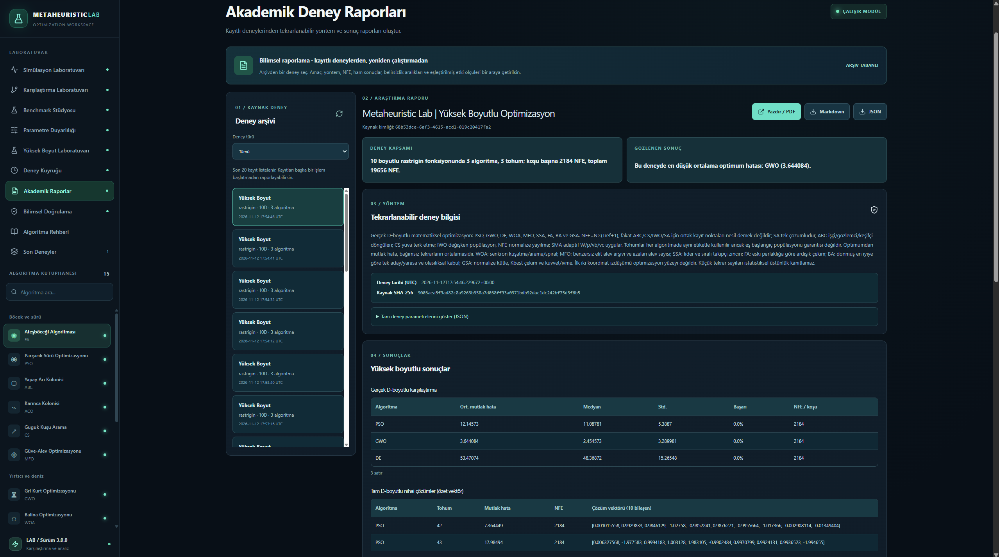

# Metaheuristic Lab — Research and Educational Optimization Workspace

[Main README](README.md) · [Türkçe](README_TR.md) · **English**


Metaheuristic Lab combines executable optimization models, interactive visualization, controlled scientific experiments, persistent research records, and reproducibility-oriented reporting in a local-first web application.

### Gallery: the actual v3.0.0 application

These are **screenshots supplied from the working v3.0.0 build**, not UI mockups. Displayed outcomes are illustrative run results, not proof of general algorithm superiority.

[](docs/screenshots/final/01-firefly-overview.png)

| Controlled NFE comparison | Discrete route optimization |
|:---:|:---:|
| [](docs/screenshots/final/06-comparison-convergence.png) | [](docs/screenshots/final/04-aco-tsp-route.png) |
| Multi-benchmark experiments | 10D full-vector optimization |
| [](docs/screenshots/final/08-benchmark-matrix.png) | [](docs/screenshots/final/13-dimensional-results.png) |
| Persistent job processing | Archive-based academic reporting |
| [](docs/screenshots/final/15-job-queue-running.png) | [](docs/screenshots/final/18-academic-report-overview.png) |

**[View the full annotated gallery: 23 images](docs/SCREENSHOT_GALLERY.md)** · [Illustrated presentation (PPTX)](docs/academic/Metaheuristic_Lab_Academic_Presentation_v3.0.0.pptx) · [PDF](docs/academic/Metaheuristic_Lab_Academic_Presentation_v3.0.0.pdf)

### Research questions the application helps explore

- How do different optimizers move through 2-D objective functions, and what algorithm-specific decisions produce those movements?
- How do continuous optimizers compare **under the same objective-evaluation budget**, using multiple labeled random seeds?
- How do objective functions, dimensions and one-factor-at-a-time parameter changes affect error and convergence?
- Can a recorded run's NFE, solution vector, convergence trace, and summary metrics be independently checked for internal consistency?

### Capabilities

**15 simulations:** Firefly Algorithm (FA), Particle Swarm Optimization (PSO), Artificial Bee Colony (ABC), Ant Colony Optimization (ACO), Cuckoo Search (CS), Moth-Flame Optimization (MFO), Grey Wolf Optimizer (GWO), Whale Optimization Algorithm (WOA), Bat Algorithm (BA), Salp Swarm Algorithm (SSA), Slime Mould Algorithm (SMA), Invasive Weed Optimization (IWO), Simulated Annealing (SA), Gravitational Search Algorithm (GSA), and Differential Evolution (DE).

The continuous laboratory supports **14 algorithms in 2, 5, 10 and 30 dimensions** on Sphere, Rastrigin, Ackley, Rosenbrock and Griewank. ACO operates separately on a discrete symmetric Euclidean TSP problem. Other labs include scientific comparison, a benchmark suite, OFAT sensitivity, academic reporting, science audit and a SQLite-backed persistent experiment queue with completed-run checkpointing.

**Technology:** Python 3.13, FastAPI, NumPy, Pydantic, SQLite; React 19, TypeScript, Vite 6, Tailwind CSS 4; Pytest, Playwright, Docker Compose, Nginx, GitHub Actions.

### Local installation

Backend (PowerShell):

```powershell
cd backend
py -3.13 -m venv .venv
.\.venv\Scripts\python.exe -m pip install -r requirements-dev.txt
.\.venv\Scripts\python.exe -m uvicorn app.main:app --reload
```

Frontend (second terminal):

```powershell
cd frontend
npm.cmd install
npm.cmd run dev
```

Open `http://127.0.0.1:5173`; API docs at `http://127.0.0.1:8000/docs`. For local Docker deployment run `docker compose up --build -d --wait` from the root and browse `http://127.0.0.1:5173`.

### Testing

```powershell
cd backend
.\.venv\Scripts\python.exe -m pytest -q
```

```powershell
cd frontend
npm.cmd run build
npm.cmd run report:bundle
npm.cmd run test:e2e
```

Windows v3.0.0 verification passed **547/547 backend tests, 12/12 Playwright E2E scenarios**, and a TypeScript/Vite production build. Local Docker verification reported **API 3.0.0 and two healthy containers**. GitHub Actions results must still be verified after the repository is published. See [release checklist](docs/RELEASE_CHECKLIST.md).

### Engineering notes

The comparison x-axis represents NFE, not matched iteration counts. SA is single-solution; IWO uses variable population; ACO is a discrete graph-search problem. Statistical significance cannot be inferred from 2–3 runs, and equal NFE is not equal runtime. Checkpoints are saved **after completed independent runs**, not during optimizer iterations. Results are stored locally; user authentication and production-grade Internet security are not implemented.

Documentation: [architecture](docs/FINAL_ARCHITECTURE.md) · [scientific methods](docs/DIMENSIONAL_METHODOLOGY.md) · [audit](docs/SCIENTIFIC_VALIDATION.md) · [reproducibility](docs/REPRODUCIBILITY.md) · [limitations](docs/RESEARCH_LIMITATIONS.md) · [local deployment](docs/DEPLOY_LOCAL.md).

**Publication note:** 23 actual v3.0.0 screenshots have been supplied and included in the curated [gallery](docs/SCREENSHOT_GALLERY.md). Review images for local job/archive identifiers before publishing. Source code is licensed under the **[MIT License](LICENSE)** (Copyright © 2026 Fatih Yılmaz). Check screenshot permissions and any third-party assets before public release; see the [release checklist](docs/RELEASE_CHECKLIST.md).
