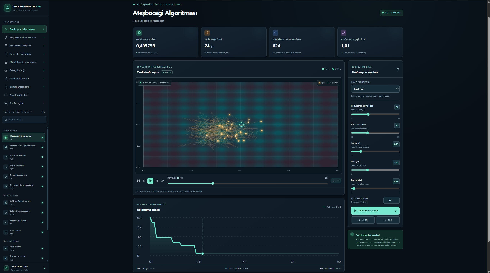
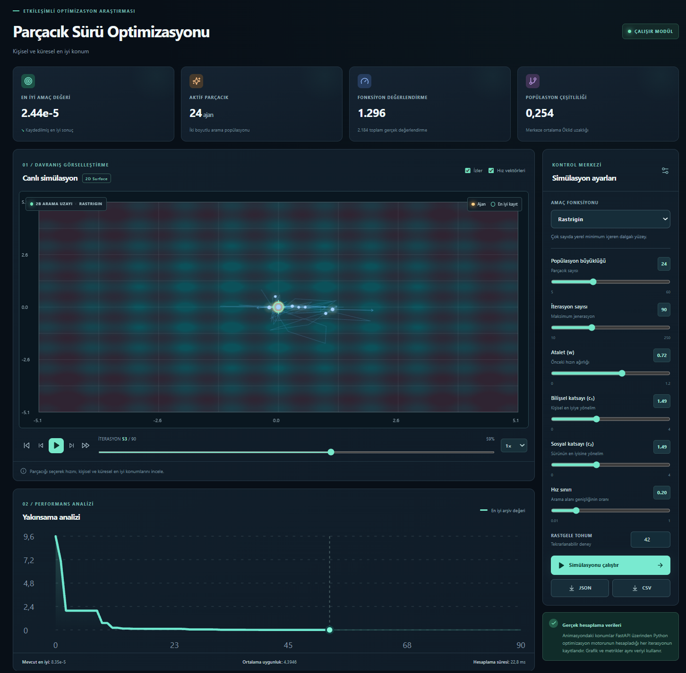
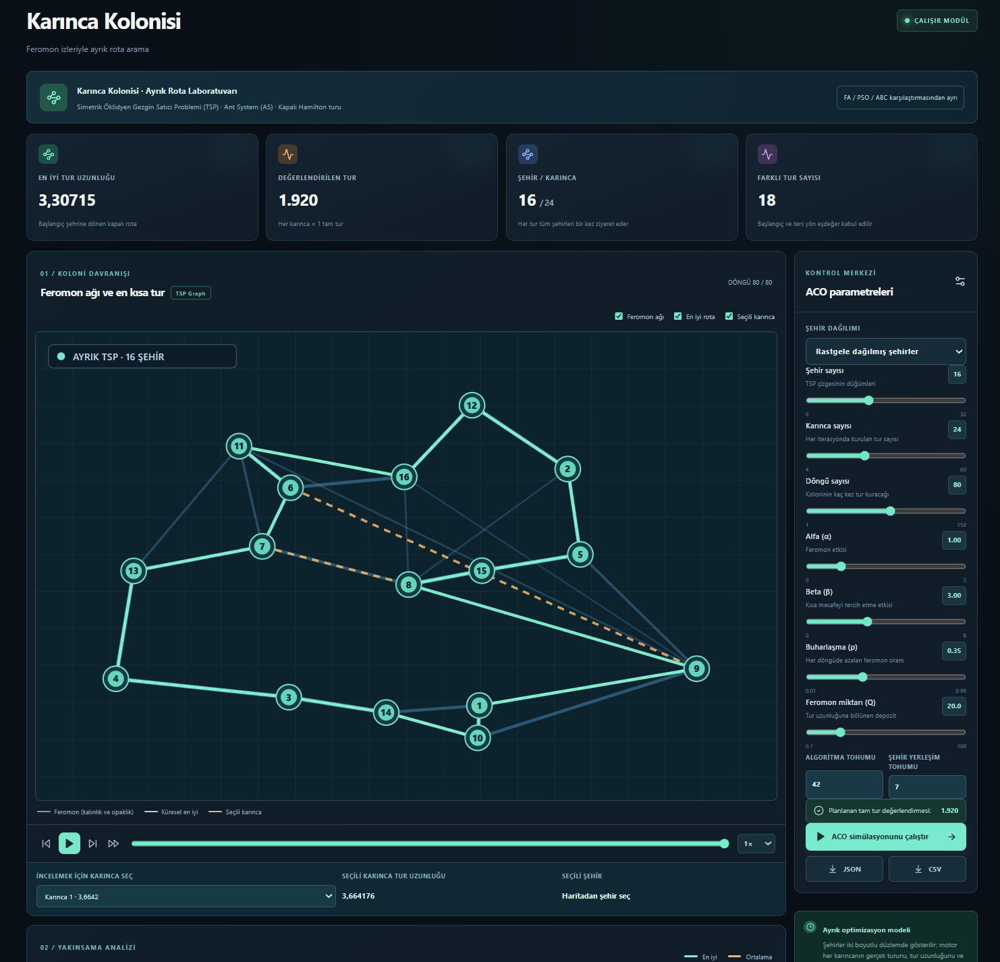
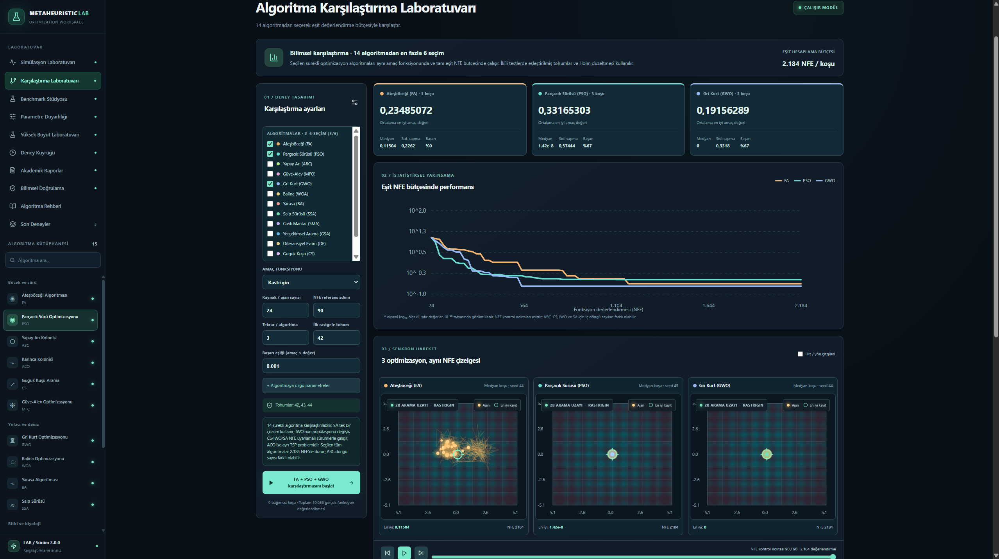
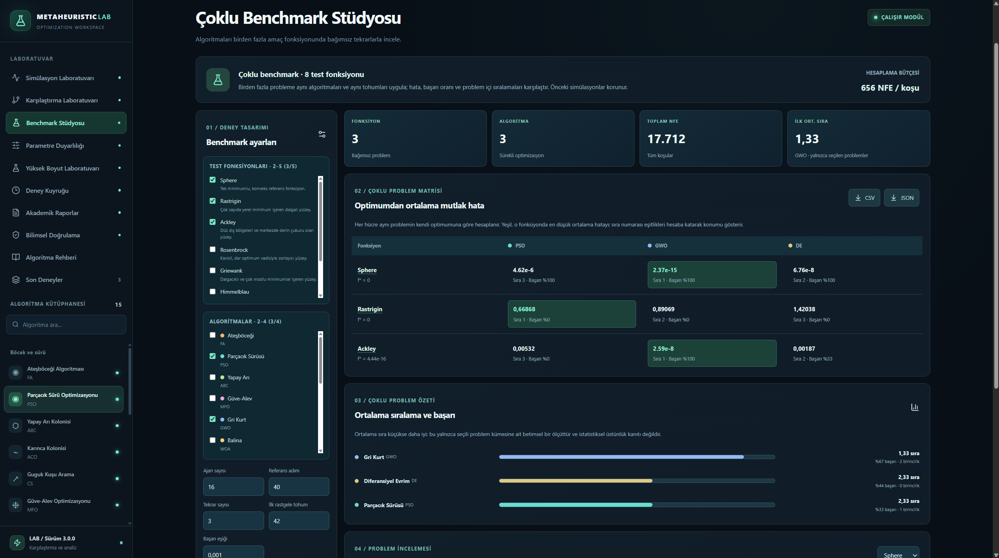
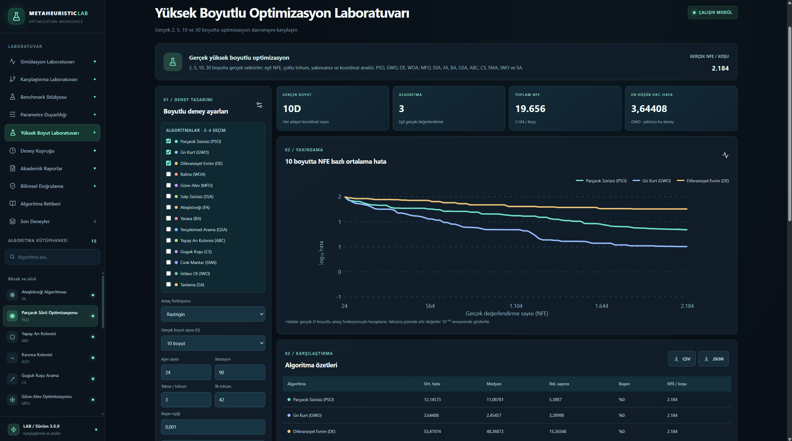
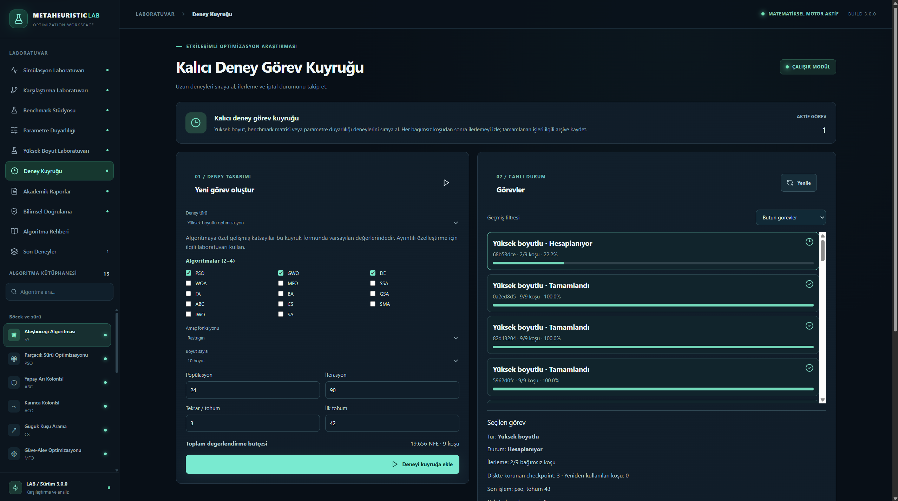
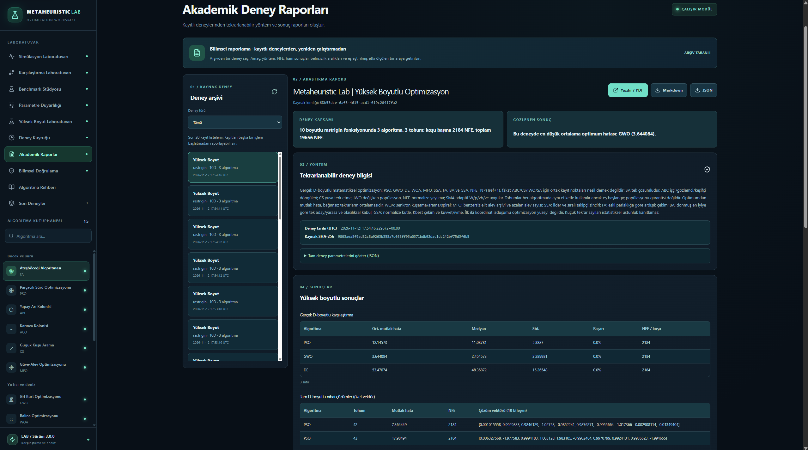
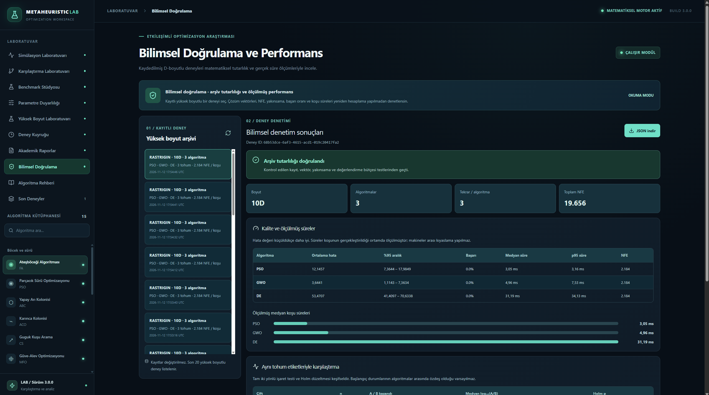

# Metaheuristic Lab — Meta-sezgisel Optimizasyon Araştırma Laboratuvarı

[Ana README](README.md) · **Türkçe** · [English](README_EN.md)

**Metaheuristic Lab**, meta-sezgisel optimizasyon algoritmalarını gerçek hesaplama yörüngeleriyle görselleştiren, aynı değerlendirme bütçesiyle karşılaştıran, tekrarlanabilir deneyler yürüten ve sonuçları bilimsel açıdan denetleyen yerel web uygulamasıdır.

### Proje ne yapıyor?

- **15 algoritma:** Ateşböceği (FA), Parçacık Sürü (PSO), Yapay Arı Kolonisi (ABC), Karınca Kolonisi (ACO), Guguk Kuşu (CS), Güve–Alev (MFO), Gri Kurt (GWO), Balina (WOA), Yarasa (BA), Salp (SSA), Cıvık Mantar (SMA), İstilacı Ot (IWO), Tavlama Benzetimi (SA), Yerçekimsel Arama (GSA) ve Diferansiyel Evrim (DE).
- **14 sürekli algoritma:** 2/5/10/30 gerçek boyutta Sphere, Rastrigin, Ackley, Rosenbrock ve Griewank problemlerinde çalışır. **ACO ayrı bir ayrık TSP problemidir.**
- **Deney laboratuvarları:** Simülasyon, eşit NFE karşılaştırması, çoklu benchmark, OFAT parametre duyarlılığı, yüksek boyut, akademik rapor, bilimsel doğrulama ve kalıcı Deney Kuyruğu.
- **Güvenilir deney akışı:** Sabit tohumlar, gerçek fonksiyon değerlendirme sayısı (NFE), yakınsama kayıtları, SQLite arşivi, koşu bazlı checkpoint, tekrar deneme, koşular arasında iptal, CSV/JSON/Markdown ve yazdırılabilir HTML.

### Uygulamadan gerçek ekran görüntüleri

**Bu ekranlar v3.0.0 uygulamasından alınmıştır.** Görsellerdeki deneyler pilot/örnek çalışmalardır; bütün problemler için algoritma üstünlüğü anlamına gelmez.

[](docs/screenshots/final/01-firefly-overview.png)

| Sürekli optimizasyon: FA / PSO | Ayrık optimizasyon: ACO / TSP |
|:---:|:---:|
| [](docs/screenshots/final/03-pso-simulation.png) | [](docs/screenshots/final/04-aco-tsp-route.png) |
| **NFE bazlı adil karşılaştırma** | **Fonksiyonlar arası benchmark** |
| [](docs/screenshots/final/06-comparison-convergence.png) | [](docs/screenshots/final/08-benchmark-matrix.png) |
| **10D deney ve çözüm vektörleri** | **Kalıcı görev kuyruğu ve checkpoint** |
| [](docs/screenshots/final/13-dimensional-results.png) | [](docs/screenshots/final/15-job-queue-running.png) |
| **Akademik raporlama** | **Bilimsel tutarlılık denetimi** |
| [](docs/screenshots/final/18-academic-report-overview.png) | [](docs/screenshots/final/20-scientific-validation.png) |

**[23 ekran görüntüsünün tamamını açıklamalı galeride incele](docs/SCREENSHOT_GALLERY.md)** · [Görselli sunum — PowerPoint](docs/academic/Metaheuristic_Lab_Academic_Presentation_v3.0.0.pptx) · [PDF](docs/academic/Metaheuristic_Lab_Academic_Presentation_v3.0.0.pdf)

### Teknolojiler

**Backend:** Python 3.13, FastAPI, NumPy, Pydantic, SQLite. **Frontend:** React 19, TypeScript, Vite 6, Tailwind CSS 4. **Kalite ve dağıtım:** Pytest, Playwright, Docker Compose, Nginx, GitHub Actions.

### Windows ile başlat

**Terminal 1:**

```powershell
cd backend
py -3.13 -m venv .venv
.\.venv\Scripts\python.exe -m pip install -r requirements-dev.txt
.\.venv\Scripts\python.exe -m uvicorn app.main:app --reload
```

**Terminal 2:**

```powershell
cd frontend
npm.cmd install
npm.cmd run dev
```

Arayüz: `http://127.0.0.1:5173` · API: `http://127.0.0.1:8000/docs`.

**Docker:** Proje kökünde `docker compose up --build -d --wait` ile derle ve başlat; `docker compose down` ile konteynerleri durdur. SQLite kayıtların `backend/data/` içinde tutulur, bu klasörü GitHub'a yükleme. Ayrıntılar: [yerel dağıtım](docs/DEPLOY_LOCAL.md).

### Testler

```powershell
cd backend
.\.venv\Scripts\python.exe -m pytest -q
```

```powershell
cd frontend
npm.cmd run build
npm.cmd run report:bundle
npm.cmd run test:e2e
```

v3.0.0 Windows doğrulamasında **547 backend testi ve 12 Playwright senaryosu başarılı**, frontend derlemesi tamamlandı. Docker Compose üzerinde **API 3.0.0**, Nginx ve API konteynerleri `healthy` durumunda doğrulandı. GitHub Actions iş akışı ise depo yayımlandıktan sonra ayrıca kontrol edilmelidir. Windows `npm` engellerinde `npm.cmd` kullan; Rollup WASM bilgisi [burada](frontend/ROLLUP_WASM_WINDOWS.md).

### Bilimsel yorum sınırları

- **Eşit NFE, eşit nesil veya çalışma süresi değildir.** ABC, CS, IWO ve SA için NFE kontrollü uygulama ayrıntıları belgelenir.
- Aynı etiketli tohumlar algoritmalar arasında birebir aynı başlangıç popülasyonu garantilemez.
- D boyutlu optimizasyonda ilk iki koordinat grafiği yalnızca **izdüşümdür**.
- Üç tohumla istatistiksel veya genel algoritma üstünlüğü iddia edilmez; bootstrap ve ikili testler keşifseldir.
- Dahili bilimsel denetim aynı fonksiyon implementasyonunu kullanır; harici referans algoritma doğrulaması değildir.
- Tek kullanıcılı ve yereldir: giriş sistemi, HTTPS ve internete açık çok kullanıcılı servis güvenliği bulunmaz.

### Belgeler

[Mimari](docs/FINAL_ARCHITECTURE.md) · [Deney protokolü](docs/REPRODUCIBILITY.md) · [Bilimsel sınırlamalar](docs/RESEARCH_LIMITATIONS.md) · [Checkpoint](docs/CHECKPOINT_METHODOLOGY.md) · [Bilimsel raporlama](docs/SCIENTIFIC_REPORTING.md) · [Yayın kontrol listesi](docs/RELEASE_CHECKLIST.md) · [Portföy içerikleri](docs/PORTFOLIO_KIT_TR.md).

Gerçek ekran görüntülerimiz [final galeri](docs/SCREENSHOT_GALLERY.md) altında bulunuyor. Kamuya açık yayın öncesinde yerel deney/arşiv kimliklerini gözden geçir. Kaynak kodu **[MIT Lisansı](LICENSE)** ile yayımlanacaktır (Telif hakkı © 2026 Fatih Yılmaz). Görsellerin ve varsa üçüncü taraf varlıkların paylaşım izinlerini ayrıca gözden geçir.
