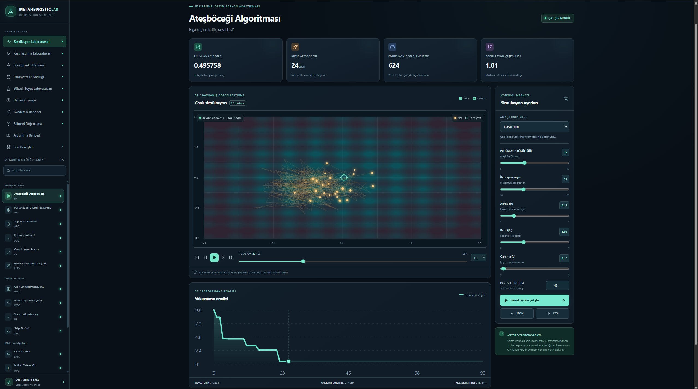
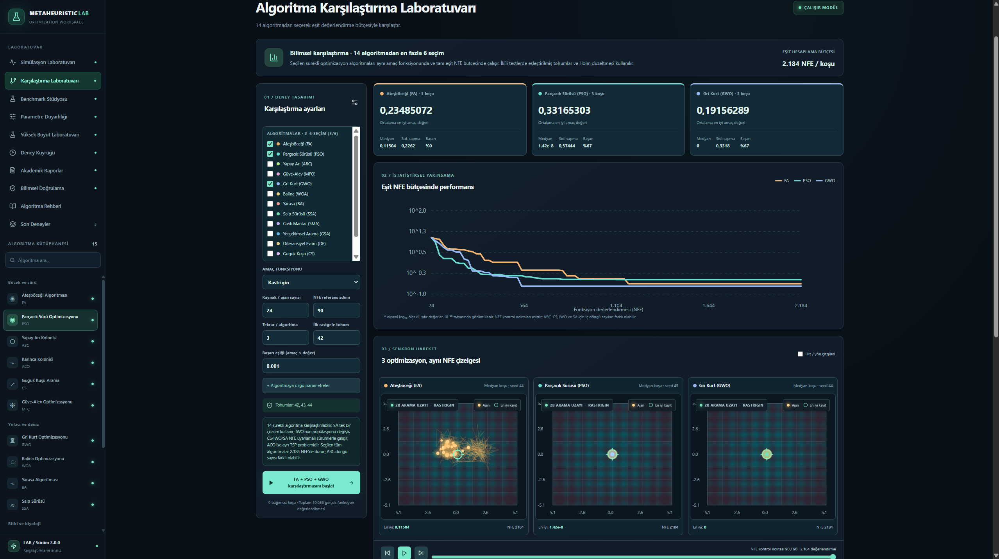
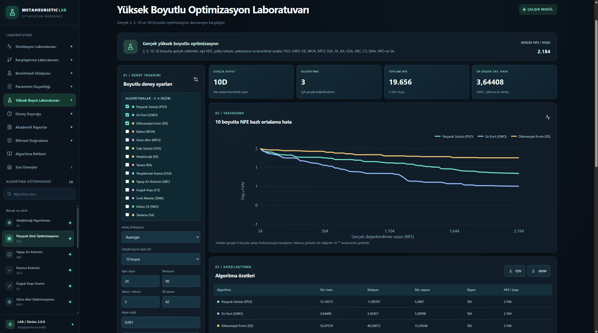
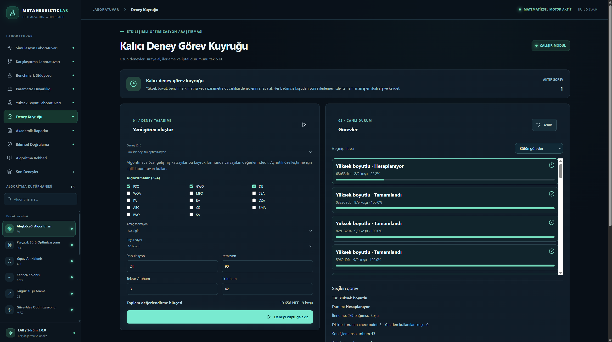
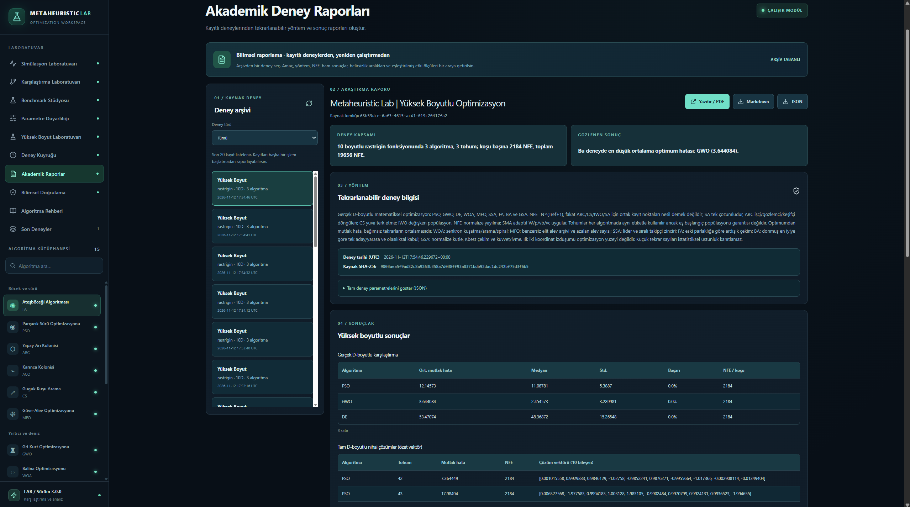
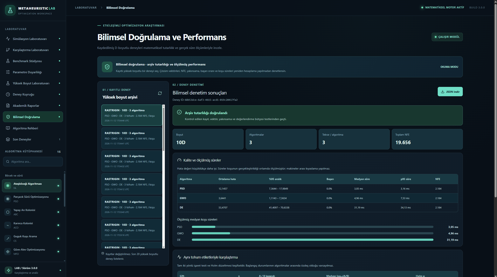

# Metaheuristic Lab v3.0.0

## Bilimsel Deney ve Yazılım Mühendisliği Teknik Raporu

**Tarih:** 12 Kasım 2026\
**Sürüm:** v3.0.0 — Yerel araştırma ve portföy yayını\
**Kapsam:** Gerçek algoritma simülasyonları, eşit-NFE kontrollü deneyler, bilimsel raporlama ve yazılım doğrulaması\
**Statü:** Teknik proje raporu; hakem değerlendirmeli bilimsel yayın veya harici algoritma sertifikası değildir.

### Özet

Metaheuristic Lab, 15 meta-sezgisel algoritmanın hesaplama sürecini etkileşimli biçimde görselleştiren ve 14 sürekli optimizasyon algoritması için çok boyutlu, tekrarlanabilir deneyler sağlayan yerel bir web uygulamasıdır. Sistem; Python/FastAPI, NumPy, SQLite, React/TypeScript ve Docker üzerine kurulmuştur. Sabit fonksiyon değerlendirme sayısı (NFE), ortak tohum etiketleri, çoklu benchmark, tek-parametre-duyarlılık çalışmaları, tam D-boyutlu sonuçlar ve iç tutarlılık denetimi yoluyla deney verilerini izlenebilir kılar. SQLite destekli kalıcı görev kuyruğu tamamlanmış bağımsız koşuları checkpoint olarak saklar. Akademik raporlar, önceki deneyleri yeniden hesaplamadan JSON, Markdown ve HTML olarak oluşturulur. Bu rapor algoritmaların genel üstünlüğünü iddia etmez; üç tohumlu pilot sonuçları metodolojik bir örnek olarak sunar.

### Abstract

Metaheuristic Lab is a local-first research and educational application integrating real simulation traces of 15 metaheuristic algorithms with fixed-NFE, repeated D-dimensional experiments for 14 continuous optimizers. The system combines algorithm-specific models, persistent SQLite-based experiments and job checkpoints, scientific consistency auditing, academic report generation, automated tests, and local container deployment. Results are intended for reproducible exploration, not as evidence of universal algorithm superiority or independent benchmark equivalence.

## 1. Problem ve amaç

Meta-sezgisel algoritmaların yalnızca nihai amaç fonksiyonu değerleri üzerinden karşılaştırılması, farklı iç döngü düzenlerini, rastgele arama davranışlarını ve hesaplama maliyetlerini gizleyebilir. Projenin hedefi, gerçek hesaplama motorlarının adımlarını görünür kılmak, tekrarlanabilir deney protokolü oluşturmak, bilimsel kaydı kalıcı saklamak ve sonuçların hesaplama tutarlılığını sınamaktır. Eğitim odağına ek olarak uygulama; REST API, veri erişim katmanları, tarayıcı otomasyonu, konteyner dağıtımı ve veri kurtarma gibi uçtan uca mühendislik bileşenleri içerir.

## 2. Algoritmalar ve problem tipleri

**15 simülasyon algoritması:** Ateşböceği (FA), Parçacık Sürü (PSO), Yapay Arı Kolonisi (ABC), Karınca Kolonisi (ACO), Guguk Kuşu (CS), Güve–Alev (MFO), Gri Kurt (GWO), Balina (WOA), Yarasa (BA), Salp Sürüsü (SSA), Cıvık Mantar (SMA), İstilacı Ot (IWO), Tavlama Benzetimi (SA), Yerçekimsel Arama (GSA) ve Diferansiyel Evrim (DE).

ACO, simetrik Öklidyen Gezgin Satıcı Problemi (TSP) üzerinde ayrık turlar ve feromon güncellemeleri kullanır. Diğer 14 algoritma, sürekli amaç fonksiyonlarında D = 2, 5, 10 ve 30 boyutta çalışabilir. Yüksek boyutlu test fonksiyonları Sphere, Rastrigin, Ackley, Rosenbrock ve Griewank'tır. İlk iki koordinatın grafiksel izdüşümü, gerçek D-boyutlu amaç yüzeyi olarak yorumlanmaz.

## 3. Sistem mimarisi

React 19/TypeScript istemcisi FastAPI REST arayüzüyle konuşur. Geliştirme ortamında Vite proxy, yerel Docker dağıtımında ise Nginx aynı-origin API yönlendirmesi sunar. Backend'de simülasyon motorları, karşılaştırma/benchmark/duyarlılık modülleri, kuyruk/checkpoint altyapısı, SQLite erişim katmanı ve bilimsel raporlama ayrı sorumluluklarla düzenlenmiştir. Veriler `backend/data/` içinde yerel SQLite dosyasında tutulur; kaynak paketine veya Git deposuna eklenmez.

Deney Kuyruğu yüksek boyut, benchmark ve OFAT parametre duyarlılığı türlerini destekler. Başarılı bağımsız koşu sonrası checkpoint yazılır. Sunucu kesintisinden sonra yalnızca tamamlanmış kayıtlar doğrulanarak yeniden kullanılır. Koşunun ortasından devam etmek desteklenmez. Kaynak veya sayısal ortam uyumsuzluğunda checkpoint sonuçlarının sessizce birleştirilmesi engellenir.

## 4. Deney metodolojisi

D-boyutlu karşılaştırma referans bütçesi `NFE/koşu = N × (T_ref + 1)` olarak belirlenir. Örneğin 24 ajan ve 90 referans adımında her koşu **2.184** gerçek amaç fonksiyonu değerlendirmesi kullanır. ABC, CS, IWO ve SA gibi algoritmaların kendi çevrim düzenleri farklıdır; ortak kayıt noktalarının algoritmanın gerçek nesli sayıldığı varsayılmaz. Eşit NFE, eşit çalışma süresi veya eşit algoritmik iç karmaşıklık garantisi değildir.

Tekrarlı deneylerde kullanıcı tarafından belirtilen `seed_start` değerinden tohumlar üretilir. Aynı tohum etiketi farklı algoritmaların birebir aynı başlangıç popülasyonunu ya da aynı rastgele sayı akışını kullandığı anlamına gelmez. Başarı, tarihsel en iyi amaç hatasının belirtilen eşik değerinin altına inmesiyle tanımlanır. Ortalama, medyan, örneklem standart sapması, başarı oranı, yakınsama ve çalışma süresi ayrı ölçülerdir.

## 5. Pilot deney (kısıtlı örneklem)

D = 10 ve Rastrigin fonksiyonunda ABC, CS, IWO ve SA karşılaştırılmıştır. Parametreler: popülasyon 24, referans adımı 90, tekrar 3, tohumlar 42–44, başarı eşiği 0,001. Her algoritma/koşu 2.184 NFE; toplam 4 × 3 × 2.184 = **26.208 NFE**.

| Algoritma | Ortalama mutlak hata | Medyan | Standart sapma | Başarı |
| --- | ---: | ---: | ---: | ---: |
| ABC | 14,00322 | 13,95148 | 5,16493 | %0 |
| IWO | 15,52093 | 15,51789 | 0,07761 | %0 |
| CS | 39,14972 | 39,98699 | 5,20915 | %0 |
| SA | 62,41598 | 61,60334 | 6,64312 | %0 |

Bu **tek pilot problemde** ABC en düşük ortalama hatayı sağlamıştır; dört algoritmanın hiçbirinde belirlenen başarı eşiğine ulaşılmamıştır. Üç tekrar ve tek problem türü genel üstünlük için yeterli değildir. İlgili raporda tüm altı ikili karşılaştırmanın Holm düzeltilmiş p değeri 1,0'dır. Sonuçlardan genellenebilir istatistiksel üstünlük sonucu çıkarılmamıştır. Veriler kullanıcı tarafından uygulamadan dışa aktarılan deney raporuna dayanmaktadır (arşiv kimliği `44271464-ca3b-45d5-9e98-5d30c981cafe`).

## 6. Bilimsel doğrulama

Bilimsel Doğrulama modülü arşivlenmiş bir deneyi yeniden koşturmadan tam D-vektör boyutunu, kayıtlı amaç değerini, NFE kontrol noktalarını, monoton tarihsel en iyiyi, grup özetlerini ve koşu sürelerini kontrol eder. Bu yeniden değerlendirme uygulamanın **kendi amaç fonksiyonu implementasyonunu** kullanır; bu nedenle harici referans kütüphaneyle bağımsız algoritma denklik testi değildir.

Belirsizlik analizi örneklem ortalaması için deterministik 4.096 yeniden örneklemeli yüzdecil bootstrap aralıklarını kullanır. Eşleştirilmiş ikili karşılaştırmalarda tam işaret testi ve Holm düzeltmesi raporlanır. Küçük örneklemlerin belirsizlik aralıkları ve p değerleri özellikle temkinli yorumlanmalıdır. Koşu süresi, algoritmanın kaydedilmiş hesaplama maliyetidir; API/Nginx/React ve disk/arayüz overhead'inin tamamı değildir.

## 7. Yazılım doğrulama ve teslim

v2.15.0 aşamasında kullanıcının Windows ortamında **540 Pytest ve 12 Playwright testinin başarılı** olduğu bildirilmiştir. v3.0.0 son geliştirme ortamında **547 backend testi başarıyla geçmiştir**. Yeni sürümün Windows TypeScript/Vite, Playwright, Docker ve GitHub Actions kontrolleri ayrı yapılmadan bu bileşenler v3 üzerinde doğrulanmış sayılmaz. Docker web servisi `127.0.0.1:5173` portunda, API ise Docker iç ağında çalışır; internete açık çok kullanıcılı servis olarak tasarlanmamıştır.

## 8. Sınırlılıklar ve sonuç

Bu proje, gerçek matematiksel yörüngelerle zenginleştirilmiş bir eğitim/araştırma sistemini, test edilebilir yazılım mühendisliği uygulamalarıyla birleştirir. Bununla birlikte CEC/COCO benchmark doğrulaması, bağımsız referans algoritma karşılaştırmaları, çok kullanıcılı kimlik doğrulama/HTTPS ve koşu içi iterasyon checkpoint'leri kapsam dışıdır. ACO'nun ayrık TSP sonuçlarıyla sürekli algoritmaların sonuçları aynı performans sıralaması olarak birleştirilemez. v3.0.0 yerel araştırma ve profesyonel portföy sürümü olarak değerlendirilmeli; bilimsel sonuçların yorumunda deney koşulları ve sınırlamalar korunmalıdır.

## Ek A — Yeniden üretim komutu

```powershell
py -3.13 .\scripts\scientific_profile.py --algorithms pso gwo de --objectives sphere rastrigin --dimensions 2 5 10 --population 16 --iterations 30 --trials 10 --seed 42 --output-dir .\outputs\profile-v300
```

Bu çalışma 2 × 3 × 3 × 10 × 16 × (30+1) = **89.280 NFE** üretir. JSON ve Markdown çıktılar profil için belirlenen yerel klasöre yazılır; arşiv veritabanı değiştirilmez.

## Ek B — Teknik kaynak belgeleri

Bu raporun kapsam ve yöntem açıklamaları proje kaynak koduna ve aşağıdaki yerel belgelere dayanmaktadır: `docs/FINAL_ARCHITECTURE.md`, `docs/DIMENSIONAL_METHODOLOGY.md`, `docs/SCIENTIFIC_VALIDATION.md`, `docs/SCIENTIFIC_REPORTING.md`, `docs/CHECKPOINT_METHODOLOGY.md`, `docs/REPRODUCIBILITY.md`. Bu rapor harici literatür taraması veya hakemli bibliyografya yerine geçmez.


## Uygulamadan gerçek görsel kanıtlar (v3.0.0)

Bu bölümde kullanıcı tarafından çalışır uygulamadan alınan ekran görüntüleri yer alır. Her görsel ilgili deney türünün arayüzünü belgelemektedir; matematiksel modelin bağımsız dış doğrulaması olarak sunulmaz.

### Simülasyon / gerçek yörüngeler


### Eşit NFE ile bilimsel karşılaştırma


### 10 boyutlu optimizasyon


### Kalıcı deney kuyruğu / checkpoint


### Akademik rapor / istatistikler


### Bilimsel doğrulama


[Genişletilmiş 23 görsellik galeri](SCREENSHOT_GALLERY.md)
