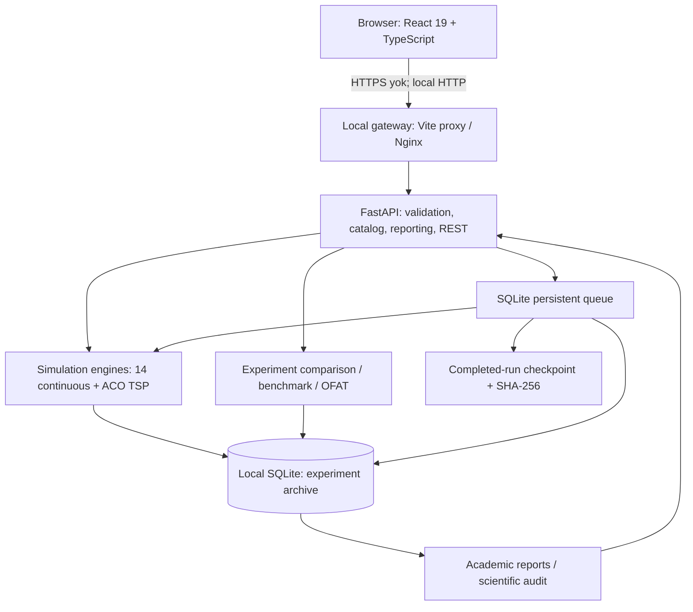

# Metaheuristic Lab v3.0.0 — Sistem Mimarisi

## Bileşen haritası

## Backend

| Modül | Görev |
| --- | --- |
| `backend/app/main.py` | FastAPI REST giriş noktaları, katalog, istatistik, raporlar ve kuyruk yaşam döngüsü |
| `backend/app/optimizers/` | Tekil algoritma hesaplamaları, 2B durumu ve algoritmaya özgü izler |
| `backend/app/dimensional.py` | 14 D-boyutlu algoritma, eşit-NFE deneyleri, bağımsız tohum koşuları |
| `backend/app/comparison.py` / `benchmark_suite.py` / `sensitivity.py` | Kontrollü deney tipleri |
| `backend/app/job_queue.py` | Kalıcı görevler, olay geçmişi, iptal/yeniden deneme, koşu checkpoint'leri |
| `backend/app/*_store.py` | SQLite arşiv ve listeleme erişimi |
| `backend/app/reports.py` | Arşivden rapor üretimi ve JSON/Markdown/HTML formatları |
| `backend/app/scientific_validation.py` | NFE, vektör, yakınsama, istatistik ve çalışma süresi tutarlılığı denetimi |

Tekil simülasyonların etkileşimli hareket kayıtları ile yüksek boyutlu deneylerdeki geçmiş en iyi vektör kayıtları farklı çıktılardır. API model doğrulaması ve hesaplama bütçesi sınırları bulunmaktadır.

## Frontend

- React 19 + TypeScript + Vite 6. Laboratuvar bileşenleri `React.lazy` ile gerektiğinde yüklenir.
- Simülasyon alanları ve yakınsama grafiklerinde gerçek API verileri kullanılır; görüntü yalnızca ilk iki koordinatı gösterebilir.
- Bileşenlerin yükleme ve hata durumları, klavye erişimi, mobil menü ve sürüm etiketleri v2.15'te gözden geçirildi.
- `frontend/nginx.conf` `/api/` isteklerini Docker iç ağındaki API'ye yönlendirir. Geliştirmede `frontend/vite.config.ts` proxy kullanır.

## Persistence ve kurtarma

- `backend/data/` ve yerel kullanıcı arşivleri Git dışındadır.
- Görev kuyruğu üç tür deney destekler: yüksek boyut, benchmark ve OFAT duyarlılığı.
- Checkpoint tamamlanmış **bağımsız koşu** başına alınır. Yarım kalmış tek koşunun ortasından devam edilmez.
- Yeniden kullanılan checkpoint'in bütünlüğü ve motor/sayısal ortam parmak izi denetlenir. Uyuşmazlıkta sonuçlar sessizce birleştirilmez.
- Başarılı işin akademik arşivi kalıcıdır; kuyruk geçmişinden silme arşivi silmez.
- Yedekleme SQLite online backup API ile yapılır; `scripts/backup_experiments.py` kullanılır.

## Dağıtım sınırı

`docker-compose.yml` web portunu yalnızca `127.0.0.1` üzerinde açar; API için host portu tanımlanmaz. **Bu sistem yerel araştırma/portföy çalışması içindir; halka açık üretim platformu değildir.** Kimlik doğrulama, HTTPS, kullanıcı bazlı veri ayırma veya dağıtık worker sağlanmaz.
